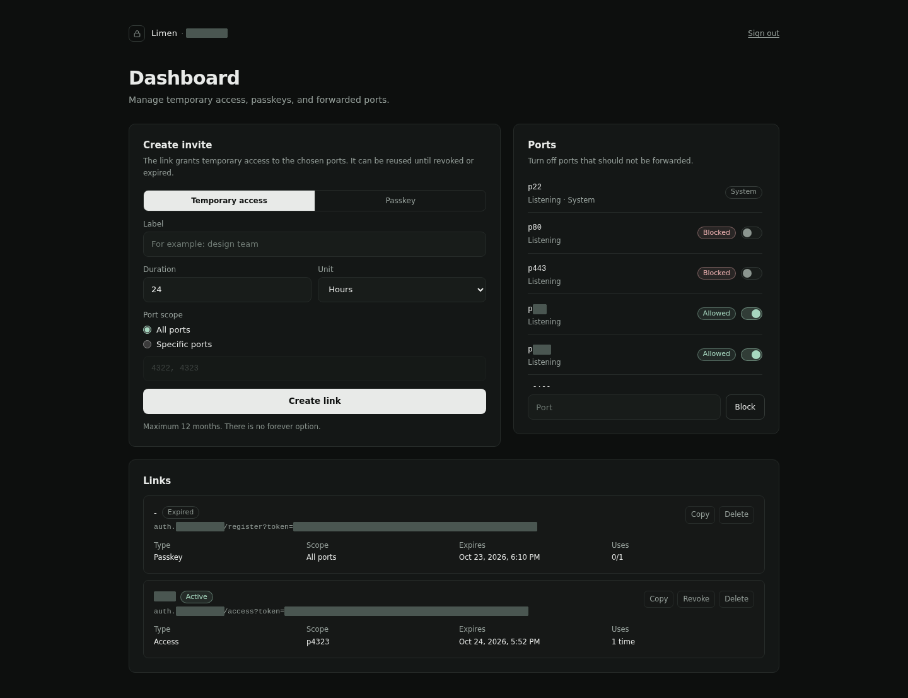

# Limen

Private access to local dev servers through one domain, with passkeys instead of a password.

Start a server on port 4323, open `https://p4323.example.com`, and you land on it. Everything behind the domain needs a passkey. Invite links can grant temporary, port-scoped access without handing out a credential.



## Why this exists

I built this because showing a project to someone was always more work than the project itself.

An SSH tunnel meant the other person needed a client, and I had to hand over a key or a password. Ngrok and the hosted tunnels dropped the client but wanted an account and a token first. Both added steps before anything was visible on their screen.

So I wrote my own. Whatever port is already listening shows up at `p<port>.<domain>`, with no registration step. The dashboard lists what is up so I can block what I do not want exposed. A passkey is the only way in. When a friend or a client needs to see one app, I send a link with an expiry date.

A domain is still required. Yes, it is a must. Certificates and cookies need one, and wildcard DNS is what makes `p<port>` work. The tunnel runs on a free Cloudflare account.

## How it works

```
browser -> Cloudflare (edge host filter) -> tunnel -> Caddy -> auth gate -> your app
```

- Caddy maps `p<port>.<domain>` to `localhost:<port>` after asking the auth service for permission.
- The auth service is a Bun app with SQLite for passkeys, invites, sessions, blocked ports, and an audit log.
- Passkeys are bound to the zone, so one credential works on every port host.
- Guests get a scoped session from an invite link. The owner gets a session from a passkey and reaches every port.
- A Cloudflare Worker rejects hostnames that do not follow the scheme before they reach the tunnel.

Only the auth host and the port hosts answer. The SSH port, the proxy port, and the auth port cannot be blocked from the dashboard.

## Temporary guest access

The owner signs in with a passkey. The guest does not need one, or an account anywhere.

From the dashboard, pick the ports, set how long the link lives (one minute up to twelve months), and send the URL. Opening it creates a session for those ports only. Everything else stays closed, and the session ends when the invite expires or you revoke it.

Normally this is where a VPN or a user account would come in. Here, the guest never sees the dashboard, and revoking the link drops the sessions it created.

Passkey invites work the other way: one credential for one device, and that device gets the owner's access to every port.

## Requirements

- Docker with Compose.
- A Cloudflare zone with a tunnel, wildcard DNS (`*.example.com`), and a wildcard certificate.
- A browser with passkey support and a device with a screen lock.
- [`gloak`](https://github.com/StackNadi/gloak) if you want offsite backups. It is a separate MIT tool in Go; build it from its own source and place the binary where `GLOAK_BIN` points.

## Who this is not for

Limen assumes you already own a domain on Cloudflare and are willing to run Docker on the host. If one of these is closer to what you need, use it instead:

- Access from your own devices only: `tailscale serve` publishes a port to your tailnet in one command, with no domain.
- A public URL with no login: Tailscale Funnel, or a Cloudflare Quick Tunnel.
- Authentication without maintaining code: Cloudflare Access in front of the same tunnel, free for up to 50 users.
- A self-hosted gateway with a web UI and SSO: Pangolin.

One default to check before you install: blocked ports are opt-in. Every port that is listening answers on `p<port>.<domain>` once a passkey session exists, unless you block it from the dashboard. On a laptop that runs only dev servers, that is the point. On a host with a database or an admin panel on a well known port, block those ports first.

## Quick start

The Cloudflare side (tunnel, wildcard DNS, edge Worker) is a one time setup. Follow [docs/CLOUDFLARE.md](docs/CLOUDFLARE.md) first.

```bash
git clone <repo> ~/limen
cd ~/limen
cp .env.example .env
$EDITOR .env          # set LIMEN_DOMAIN and LIMEN_AUTH_HOST
docker compose pull
docker compose up -d
```

The auth image comes from `ghcr.io/syrup/limen`. Set `LIMEN_IMAGE_TAG` in `.env` to pin a release instead of following `latest`. The proxy runs the upstream Caddy image. To build from source, add the build override:

```bash
docker compose -f docker-compose.yml -f docker-compose.build.yml up -d --build
```

Check the service:

```bash
curl -s https://auth.example.com/health   # {"ok":true}
```

With no passkey registered yet, create the first invite from the shell:

```bash
docker compose exec auth bun run src/invite.ts
```

Open the printed link, approve the passkey prompt, then use the dashboard at `https://auth.example.com/admin`.

## Configuration

Everything that differs between installs lives in `.env`. The full table is in [docs/WORKFLOW.md](docs/WORKFLOW.md#configuration). Two values are required, and Compose refuses to start without them:

| Variable | Example |
|---|---|
| `LIMEN_DOMAIN` | `example.com` |
| `LIMEN_AUTH_HOST` | `auth.example.com` |

Missing values stop the auth service with exit code 78 instead of falling back to a default.

## Tests

```bash
make test        # auth and worker suites
make typecheck   # tsc against auth/src
```

Both suites use temporary state and never touch a running deployment.

## Status

Built for a single owner on one host. There is no multi-user store, no session list in the dashboard, and SQLite allows one writer. I run it every day on my own machine. I am still working on it.

## Docs

- [docs/GUIDE.md](docs/GUIDE.md): day to day use, written for someone who just wants to open a dev server.
- [docs/CLOUDFLARE.md](docs/CLOUDFLARE.md): tunnel, DNS, Worker deployment with Wrangler, and the R2 backup bucket.
- [docs/WORKFLOW.md](docs/WORKFLOW.md): request path, security properties, operations, backup and restore, failure modes.
- [worker/README.md](worker/README.md): deploying and rolling back the edge filter.
- [CONTRIBUTING.md](CONTRIBUTING.md): setup, tests, layout, and [adding a language](CONTRIBUTING.md#adding-a-language).

## Security

Passkeys are bound to the zone, cookies are `HttpOnly`, invite tokens are HMAC-derived and redacted from logs, and the gate runs before the proxy contacts your app.

- The owner is the only identity. There is no user store and no password to share or reset.
- A guest session reaches only the ports listed in its invite, and nothing else.
- Port checks happen inside the auth service, before Caddy contacts the upstream.
- Whoever holds the Cloudflare account or the tunnel credentials can take over the hostnames.
- A live invite link works for anyone who has it.
- The app behind a port is trusted, because it shares the cookie namespace.

The full list, including what this does not protect against, is in [docs/WORKFLOW.md](docs/WORKFLOW.md#security-properties).

## License

MIT. See [LICENSE](LICENSE).
